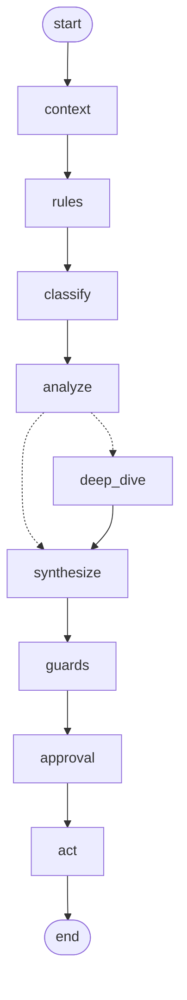

# Release-gate triage

An agent that triages code submissions which failed or got stuck at a test gate. It reads the run's log, looks up what other systems know, recommends one action from the operator's policy, and waits for a person to approve it.

Built on LangGraph and evaluated in LangSmith, for a take-home exercise. **All data is synthetic.** The store and its API are local stand-ins for a customer's gate, ticketing and source systems.

## The problem

A code change has to pass a test gate before release. That gate is the "release gate" in the project's name. These documents call it the test gate, or just the gate. The stakeholder is a software release operations team, which runs the gate and is on call for it. When a run fails or does not finish, one of its operators reads a long, noisy log, checks other systems (what else is failing on the release line, open tickets, new commits), and decides whether to fix, rerun, escalate, route to another team, wait, or do nothing.

Most of that is routine and all of it is slow. A wrong call costs time, or runs more jobs into an outage.

## What the system does

Code fetches and compares, the model reads, and code and a person decide.



| Step | Done by | What it does |
| --- | --- | --- |
| `context` | code | Looks up the facts the policy always needs, and does the number comparisons |
| `rules` | code | Makes the first call. Decides two answers outright. The fallback if the model fails |
| `classify` | model | Confirms or overrides the rules' class, from the log |
| `analyze` | model | One quick look at what went wrong, and whether it is sure |
| `deep_dive` | model with tools | A second look that may call lookup tools, only when the quick look is not sure |
| `synthesize` | model | Writes the conclusion and picks the action, from the policy |
| `guards` | code | Enforces the rules the model cannot override |
| `approval` | person | Approves, edits or rejects |
| `act` | code | Records the approved action, once |

The experiments run the graph up to `guards`. The approval and the recorded action are added when the graph is built with a checkpointer, as `review.py` does.

## If you have twenty minutes

1. This page, down to Limits.
2. [`agent/graph.py`](agent/graph.py). The docstring at the top is the map. Then read `approval_node` and `act_node`.
3. [EVALUATION.md](EVALUATION.md), the sections "The result" and "Dataset design".
4. [FRICTION_LOG.md](FRICTION_LOG.md), Part 1, on what cost real time with LangGraph and LangSmith.

## The documents

| Document | What it covers |
| --- | --- |
| [EVALUATION.md](EVALUATION.md) | The results, how the dataset was built, the two misses, and what the evaluation cannot show |
| [DECISIONS.md](DECISIONS.md) | Each design choice, what was considered instead, and what it costs |
| [PRODUCTION.md](PRODUCTION.md) | What running this for real customers would take |
| [FRICTION_LOG.md](FRICTION_LOG.md) | What was hard or unclear in LangGraph and LangSmith while building this |
| [demo/README.md](demo/README.md) | How to run the demo yourself |
| [data/HELDOUT_SPEC.md](data/HELDOUT_SPEC.md) | The only document the writer of the held-out cases was shown |

`store/` is the stand-in for the customer's systems and can be skipped on a first read.

## Results

On 45 held-out cases the agent picked the operator's action on 44, and on 43 in a later second run. The best code-only baseline picked 36.

| Variant | Right action | 95% interval |
| --- | --- | --- |
| Rules alone, as the agent's fallback (no model) | 27 of 45 (60%) | 45% to 73% |
| Rules, with the policy applied in code (no model) | 36 of 45 (80%) | 66% to 89% |
| Full agent | 44 of 45 (98%) | 88% to 100% |
| Agent without lookup tools | 44 of 45 (98%) | 88% to 100% |
| Agent without the rules' hint (one run) | 44 of 45 (98%) | 88% to 100% |
| Full agent, a second run made later (one run) | 43 of 45 (96%) | 85% to 99% |

Agent variants were run three times per case, except where marked. The held-out cases were written by a separate AI session that was shown only a spec.

- **The agent beats the best code-only baseline, 9 cases to 1.** That baseline applies the policy in code to the facts the system already looks up. It was written after the held-out run.
- **The model's value is reading the log to get the class.** Given the right class, a short function picks the right action on 44 of 45. Moving the choice of action into code is the first change to make.
- **About six seconds and a tenth of a cent an issue** (median, from the second run).
- **The lookup tools and the rules' hint are not shown to help.** The score is the same without either. The deep dive itself, a second look that is 16% of the cost, was never switched off, so it is untested.
- **One miss in the first runs,** the same case every time. The second run missed that case and one more.

The dataset and experiments are [public in LangSmith](https://smith.langchain.com/public/614dad13-73bb-452d-b90a-a54fb6df6345/d). Most of the first runs' traces were not stored there. [EVALUATION.md](EVALUATION.md) says why, and why there is a second run.

## Limits

- The data is invented, and the test set is built around the hard edges of the policy. It is not a sample of real issues, so these numbers say how well the agent follows the written policy, not how often it would be right on real traffic.
- The held-out cases were written by a model from the same family as the agent. They were checked before any run.
- At 98%, the test has almost no room left to show that a part of the system helps.
- There is no class for a flaky test, and no "cannot tell" answer. A person's approval is the safety net.
- The class is a hard constraint. A wrong class cannot be corrected by a later step, which caused the one consistent miss.
- The outage rule counts failing peers with no time window and no common cause.
- Who approved an action is not recorded.
- No sign-in, one process, local files, not load tested. It runs under the local LangGraph server and has not been deployed to a hosted one. See [PRODUCTION.md](PRODUCTION.md).

## Set up

```
uv sync
cp .env.example .env                  # then fill in the two API keys
uv run python -m store.load_store     # builds store.db from the files in sources/
uv run pytest                         # the tests: no network, no API key needed
uv run ruff check . && uv run ruff format --check .   # lint and formatting
```

## Run it

One issue, through to approval:

```
uv run python review.py start dev-04       # runs until it pauses for a person
uv run python review.py list               # every saved run and its status
uv run python review.py approve THREAD     # or: edit THREAD ACTION, reject THREAD
```

`uv run python console.py dev-04` does the same in one command, as a console for the demo. With no case it shows a list to pick from. It is a display over `review.py` and decides nothing itself.

The same graph behind a server, with the server supplying the storage (`langgraph.json`, `agent/served.py`):

```
uv run langgraph dev --allow-blocking --no-browser   # a local LangGraph server on port 2024
uv run python demo/serve_check.py                    # in another terminal: start, pause, approve, through the SDK
```

Read a case as a person would:

```
uv run python show_case.py dev-04
```

The evaluation:

```
uv run python -m evaluation.upload_dataset                # the cases, to LangSmith
uv run python -m evaluation.run_experiment agent test     # variants: rules-only, agent, no-tools, no-hint
uv run python -m evaluation.results test                  # the results, with intervals
uv run python -m evaluation.gate                          # pass or fail against the saved baseline
```

## Where things are

| Path | What is in it |
| --- | --- |
| `agent/` | The triage workflow. Start at `graph.py`. |
| `agent/domain.py` | The vocabulary, which is five classes and the actions each allows |
| `agent/policy.py` | The operator's written rulebook, which the model reads |
| `agent/rules.py` | Code's first call on the class, and the fallback |
| `agent/guards.py` | What code enforces after the model |
| `agent/served.py`, `langgraph.json` | The graph as a LangGraph server runs it |
| `store/` | The stand-in for the customer's systems, made of case files, a SQLite store, a read-only API, and the MCP server generated from it |
| `evaluation/` | Evaluators, the judge, experiments, the results report, the gate and its baseline |
| `review.py` | The approval command line, to start a run and then approve, edit or reject it |
| `console.py` | The same approval flow as a console for the demo. A display over `review.py` |
| `show_case.py` | Prints one case as a person would read it |
| `reset_demo.py` | Deletes saved runs, preferences and recorded actions, and rebuilds the store |
| `data/` | The cases, the experiment results, and `HELDOUT_SPEC.md`, the document the held-out cases were written from |
| `sources/` | Generated from `data/` by `store/make_sources.py`. Do not edit. |
| `demo/` | A guide to the demo, a recorded run, and a check against the local server |
| `tests/` | 435 tests, offline |
